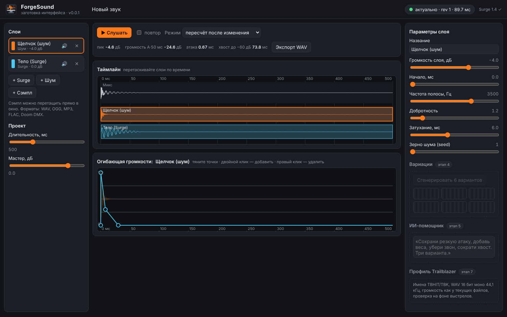

# ForgeSound-Engine
A combination of Audacity and Surge XT for creating sounds and customising them either by the user or by artificial intelligence.


## Status

- Research report (in Russian): [docs/research/forgesound-research.md](docs/research/forgesound-research.md)
- Stage 0 (Surge in Nix, render reproducibility): **done** — [docs/plan/stage0.md](docs/plan/stage0.md)
- UI skeleton: a first look at the studio, below. Stage 1 (project format, operations, undo/redo) is next.

## UI skeleton (заготовка интерфейса)

```sh
git pull && nix run        # in a clone of this repository
```

Opens `http://127.0.0.1:8737/` in the browser. The server listens on 127.0.0.1 only; nothing goes to the internet. Samples and exports are kept in `~/ForgeSound` (`FORGESOUND_HOME` to change it).



What works:

- layers: a Surge note, a noise burst, a sample (WAV, OGG, MP3, FLAC, Doom DMX; drag a file into the window);
- the timeline: drag a layer to move it in time; the mix and every layer drawn from the real render;
- the amplitude envelope of the selected layer: drag points, double click adds one, right click removes one;
- layer parameters (Surge: oscillator, note, filter, cutoff, resonance, decay; always with retrigger on);
- render-on-change with a revision number: a status shows *актуально / рендер / изменено / ошибка*, and an older render never replaces a newer one;
- metrics: peak, A-weighted loudness of the loudest 50 ms (the measure Trailblazer uses), attack, tail to −60 dB;
- play (space), loop, export to WAV 16 bit mono 44.1 kHz with a manifest.

Placeholders (later stages): variations (4), AI assistant (5), Trailblazer export profile (7), real-time preview, undo/redo and saving projects to files (1).

Development: `nix develop`, then `python -m forgesound` (runs the working copy) and `python -s -m pytest tests`.

## Stage 0 checks (NixOS, flakes enabled)

```sh
nix flake check -L
nix develop -c python -I spike/stage0/stage0_check.py --play --out spike/stage0/results-main
```

License: GPL-3.0-or-later (Surge XT, whose Python bindings ForgeSound builds and runs, is GPL-3.0).
